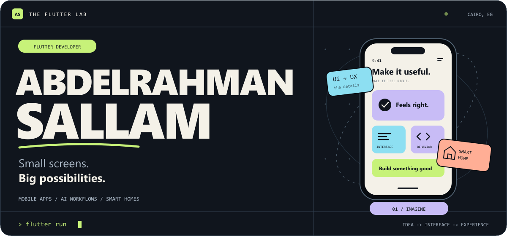
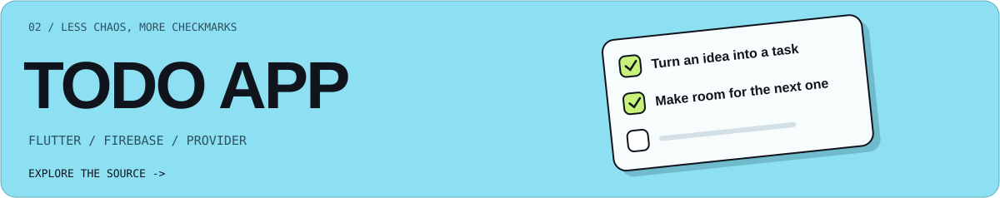
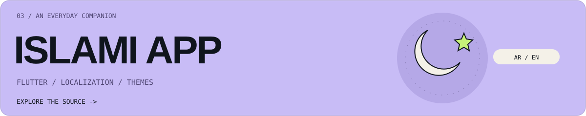
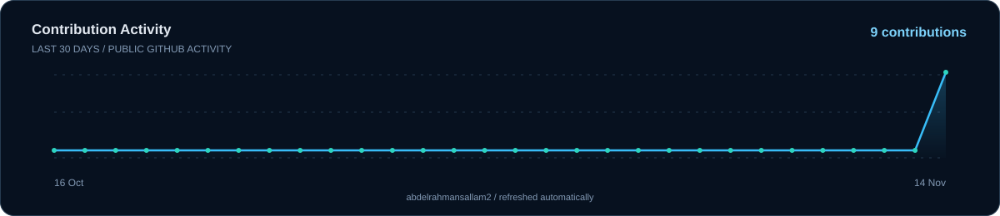
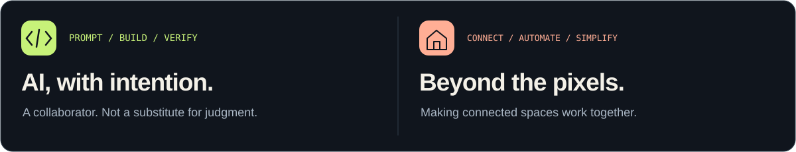
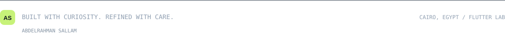

<p align="center">
  <picture>
    <source media="(prefers-reduced-motion: reduce)" srcset="./assets/profile-banner.svg" />
    
  </picture>
</p>

<p align="center">
  <a href="#the-workbench">THE WORKBENCH</a> &nbsp; / &nbsp;
  <a href="#under-the-hood">UNDER THE HOOD</a> &nbsp; / &nbsp;
  <a href="#beyond-the-screen">BEYOND THE SCREEN</a> &nbsp; / &nbsp;
  <a href="#lets-build">LET'S BUILD</a>
</p>

### Small screens. Big possibilities.

I'm **Abdelrahman Sallam**, a **Flutter Developer** and Computer Science student in Cairo. I turn ideas into mobile interfaces, connect them to real data, and keep refining the details that make an app feel right.

**My playground:** Flutter & Dart / thoughtful UI / useful automation.

## The Workbench

<a href="https://github.com/abdelrahmansallam2/seniors_2027">
  
</a>

**[Seniors 2027](https://github.com/abdelrahmansallam2/seniors_2027)** brings senior profiles, memories, daily highlights, notes, announcements, events, and polls together.

I build the Flutter experience: reusable retro widgets, REST integration with an ASP.NET Core backend, JWT authentication, secure storage, image uploads, and Android releases.

`Flutter` `Dart` `Dio` `REST APIs` `Secure Storage`

<a href="https://github.com/abdelrahmansallam2/todo-app-">
  
</a>

**[Todo App](https://github.com/abdelrahmansallam2/todo-app-)** / Task management with Firebase Authentication, Cloud Firestore, Provider, localization, and light/dark interfaces.

<a href="https://github.com/abdelrahmansallam2/islame-app-c11-sun-wed-4PM">
  
</a>

**[Islami App](https://github.com/abdelrahmansallam2/islame-app-c11-sun-wed-4PM)** / Quran, Hadith, Sebha, radio, and settings with responsive layouts, localization, and dynamic themes.

<details>
<summary><strong>One more thing: a little web experiment</strong></summary>

A [responsive wedding invitation](https://github.com/abdelrahmansallam2/Abdullah-Esraa), built with React, TypeScript, and Tailwind CSS. [Open the live site](https://abdullah-esraa-wedding-invite.vercel.app).

</details>

## Under the Hood

```dart
final developer = <String, Object>{
  'name': 'Abdelrahman Sallam',
  'focus': 'Flutter Developer',
  'toolbox': ['Dart', 'Provider', 'Firebase', 'Dio', 'Git'],
  'careAbout': ['Useful UI', 'Clear state', 'The edge cases'],
  'beyondApps': ['AI-assisted workflows', 'Smart-home automation'],
};
```

<details>
<summary><strong>Open the toolbox</strong> / what I actually work with</summary>

| Layer | My tools and focus |
| --- | --- |
| **Interface** | Flutter widgets, responsive layouts, shared themes, localization |
| **Behavior** | Provider, navigation, forms, validation, async state |
| **Data** | Firebase Auth, Firestore, REST APIs, Dio, JWT, secure storage |
| **Delivery** | Git, debugging, unit/widget tests, Android releases |

</details>

<details>
<summary><strong>Read the build log</strong> / actual GitHub contribution activity</summary>



<sub>Real GitHub contribution data, refreshed automatically.</sub>

</details>

## Beyond the Screen



**AI as a collaborator.** Clear prompts, implementation support, debugging, and iteration, with review and testing of the result.

**Code meets the real world.** Smart-device integration, connected-home workflows, automation routines, and practical troubleshooting.

<details>
<summary><strong>The person behind the commits</strong> / education, training, and experience</summary>

**Computer Science, Shorouk Academy** / 2023 - 2027, in progress.<br>
**Flutter Developer Trainee, Route** / May - September 2024 / 120-hour program.

My training covered Dart, OOP, asynchronous programming, Flutter development, structured code, and responsive mobile interfaces.

Previous client-facing work shaped how I understand requirements, explain solutions, and follow through:

| Role | Organization | Period |
| --- | --- | --- |
| Property Consultant | Views Investments | 2025 - 2026 |
| Real Estate Agent | 4U Real Estate Office | May 2024 - June 2025 |
| Real Estate Agent | Al Hamd Real Estate Marketing Office | 2023 - 2024 |

**Languages:** Arabic - native / English - intermediate (B1).

</details>

## Let's Build

An app idea, a useful collaboration, or a good technical conversation. Start here:

<p>
  <a href="mailto:ab01095702547@gmail.com"></a>
  &nbsp;
  <a href="https://www.linkedin.com/in/abdelrahman-sallam-057a62356/"></a>
</p>


