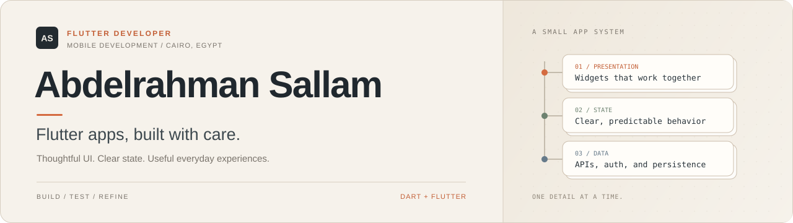
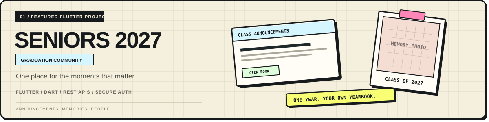

  

  <a href="#selected-work">Selected work</a> &nbsp;/&nbsp;
  <a href="#how-i-build">How I build</a> &nbsp;/&nbsp;
  <a href="#background">Background</a> &nbsp;/&nbsp;
  <a href="#contact">Contact</a>

I'm **Abdelrahman Sallam**, a **Flutter Developer** and Computer Science student in Cairo. I build cross-platform apps with thoughtful interfaces, clear state flows, and useful everyday features.

My main focus is **Flutter and Dart**. I also bring experience with web interfaces, AI-assisted development, and smart-home automation.

## Selected Work

### [Seniors 2027](https://github.com/abdelrahmansallam2/seniors_2027)

A graduation community app bringing announcements, senior profiles, memories, daily highlights, notes, events, and polls into one place.

**My work:** Flutter interfaces, reusable retro components, REST API integration with an ASP.NET Core backend, JWT authentication and secure token storage, image uploads, refresh flows, error handling, and Android release builds.

**The details I care about:** keeping sessions consistent, preserving image quality, handling asynchronous state safely, and covering regressions with widget tests.

`Flutter` · `Dart` · `Dio` · `REST APIs` · `Secure Storage`

<table>
<tr>
<td width="50%" valign="top">
02 / PRODUCTIVITY
<h3><a href="https://github.com/abdelrahmansallam2/todo-app-">Todo App</a></h3>

Account-based task management with Firebase Authentication and Cloud Firestore. Add, complete, delete, filter, and organize tasks with localized light/dark interfaces.

<code>Flutter</code> <code>Firebase</code> <code>Provider</code>

</td>
<td width="50%" valign="top">
03 / EVERYDAY UTILITY
<h3><a href="https://github.com/abdelrahmansallam2/islame-app-c11-sun-wed-4PM">Islami App</a></h3>

Quran, Hadith, Sebha, radio, and settings in a responsive Flutter app, with localization, named routing, and dynamic light/dark themes.

<code>Flutter</code> <code>Dart</code> <code>Provider</code>

</td>
</tr>
</table>

**Other work:** a [responsive wedding invitation website](https://github.com/abdelrahmansallam2/Abdullah-Esraa) built with React, TypeScript, and Tailwind CSS. [Live preview](https://abdullah-esraa-wedding-invite.vercel.app).

## How I Build

- **Reusable interfaces:** responsive layouts, shared widgets, localization, and consistent themes.
- **Predictable app behavior:** clear loading/error states, secure sessions, and careful asynchronous programming.
- **Quality beyond the happy path:** debugging, unit/widget testing, and measured performance improvements.

| Main tools | In practice |
| --- | --- |
| **Flutter & Dart** | OOP, asynchronous programming, responsive UI, reusable widgets |
| **Provider & app state** | Navigation, forms, validation, localization, light/dark themes |
| **Firebase & REST APIs** | Authentication, Firestore, Dio, JWT, encrypted token storage |
| **Git & GitHub** | Version control, code review, regression fixes, Android release delivery |

### Beyond the App

**AI-assisted development:** writing clear prompts, using coding assistants to support implementation and debugging, and reviewing and testing the results.

**Smart home & automation:** smart-device integration, automation routines, connected-home workflows, and practical troubleshooting.

**Client communication:** experience understanding requirements, presenting solutions, negotiating, and following work through to completion.

## Background

**Computer Science, Shorouk Academy** · Cairo · 2023 - 2027, in progress. 
**Flutter Developer Trainee, Route** · May - September 2024 · 120-hour program.

More about my training and client-facing experience

At Route, I studied Dart, object-oriented and asynchronous programming, Flutter app development, structured code, and responsive mobile interfaces.

| Role | Organization | Period |
| --- | --- | --- |
| Property Consultant | Views Investments | 2025 - 2026 |
| Real Estate Agent | 4U Real Estate Office | May 2024 - June 2025 |
| Real Estate Agent | Al Hamd Real Estate Marketing Office | 2023 - 2024 |

This background developed my communication, lead follow-up, negotiation, customer service, and teamwork.

**Languages:** Arabic - native / English - intermediate (B1).

Recent GitHub activity

Generated from GitHub contribution data and refreshed automatically.

## Contact

Have a mobile app in mind? Let's talk.

[LinkedIn](https://www.linkedin.com/in/abdelrahman-sallam-057a62356/) &nbsp; / &nbsp; [Email](mailto:ab01095702547@gmail.com) &nbsp; / &nbsp; [GitHub](https://github.com/abdelrahmansallam2)

Abdelrahman Sallam / Flutter Developer / Cairo, Egypt
